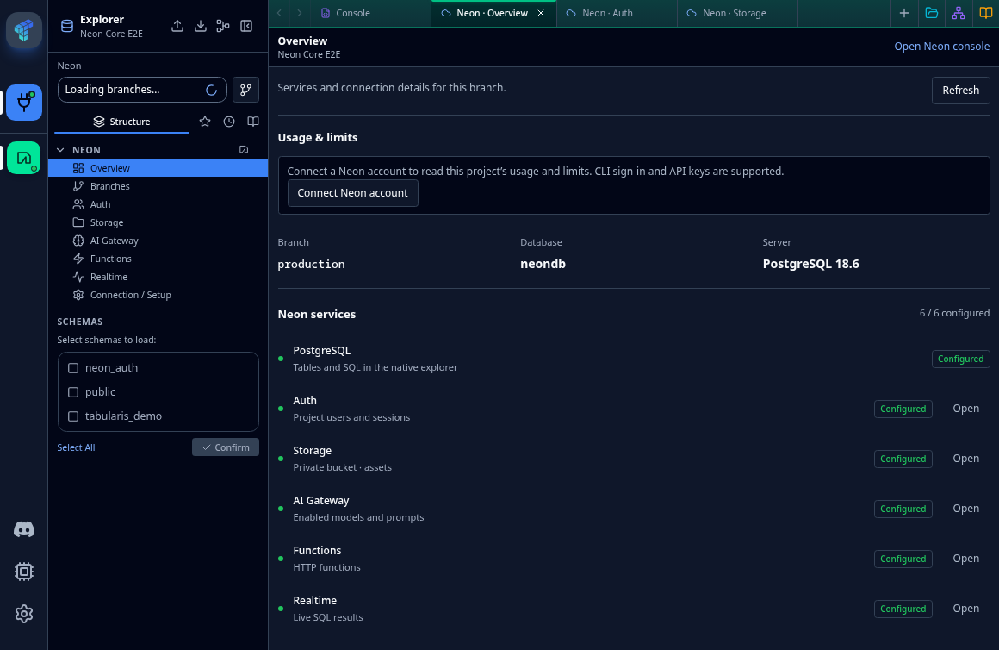
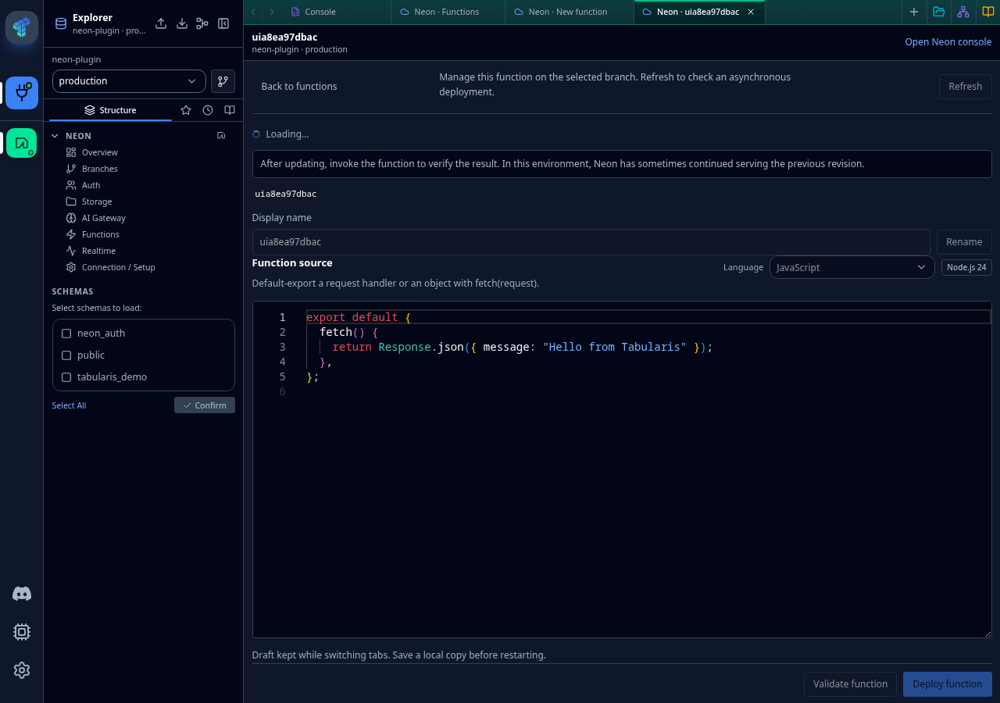
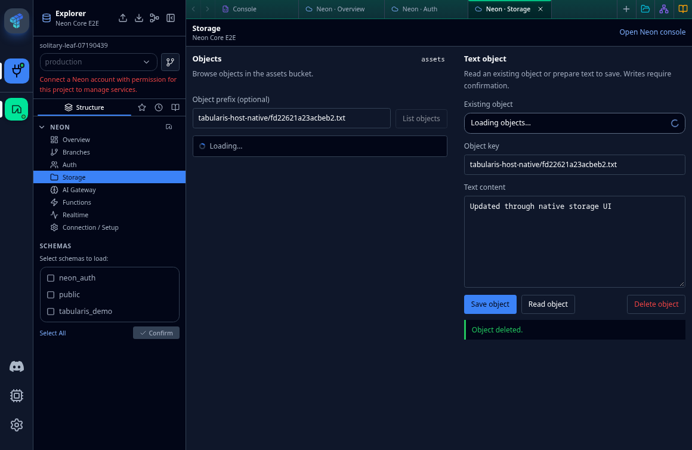
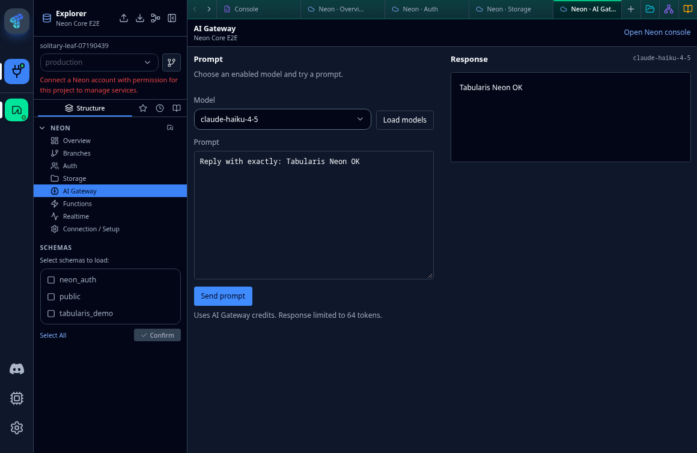

# Neon integration prototype

**Preview:** this plugin requires the provider-workspace Core branch and plugin API
0.2.7. Stock Tabularis 0.31.0 does not yet expose that API. Function redeployment
activation is a known failing live test; do not treat an accepted/active API
deployment as proof that the endpoint serves the new code or environment.

Plugin repository: https://github.com/NewtTheWolf/tabularis-neon-plugin

## Screenshots

These are actual integration-test captures using disposable source, text objects
and AI prompts. They contain no account credentials. Loading indicators and
account setup notices are part of the captured preview build.






A Tabularis driver with native explorer services for an existing Neon project. Scaffolded
with the Tabularis CLI, then adapted to Node.js to use Neon's SDKs. Requires
Node.js 22+, pnpm, and the `feat/neon-integration` Core changes on upstream
Tabularis 0.31.0. The provider UI requires plugin API 0.2.7 (SDK package 0.4.0).
The unmodified public Core does not include these provider additions; an app
version number alone does not establish support for the new UI.

Compatibility is additive in the updated Core: existing SQL drivers, legacy
drivers without optional `initialize`, and published UI API 0.1.0/0.1.1 bundles
remain supported. The browser regression matrix exercises SQLite, PostgreSQL,
MySQL, a legacy JSON-RPC driver, and an API 0.1.1 extension using its connection
hook. This does not establish that the new Neon management UI can run on an
older Core: its UI contributions explicitly require API 0.2.7 and are skipped
by hosts with a lower API version. Hosts below the manifest's runtime floor
also cannot load the full plugin.

## Build and install from this repository

From the repository root:

```sh
pnpm install --frozen-lockfile
pnpm build:plugin-api
cd plugins/neon
pnpm install --frozen-lockfile
pnpm --dir ui install --frozen-lockfile
pnpm build
pnpm test
pnpm --dir ui typecheck
pnpm --dir ui test
node scripts/install.mjs
```

`pnpm build` builds **both** the stdio runtime and the UI bundle. The installer
copies an explicit whitelist into the current `plugins/drivers/neon` directory,
including its runtime dependencies and UI, and excludes credentials. It refuses
to replace another installation. Restart Tabularis or re-enable Neon to load it.
The destination is a real directory: current Tabularis discovery ignores symlinks.

To produce a self-contained ZIP containing runtime dependencies and UI:

```sh
pnpm package
```

The ZIP still requires Node.js 22+ on the target machine. It does not contain a
Node runtime. It includes no `.env`, `.neon`, test accounts or checkout symlinks.
Release publication/signing is outside this prototype.

## Configure a connection

### Connect an existing Neon account

On **Connections**, choose **Add Connection → Neon**. Neon has its own catalogue
entry and supplies its account/project setup inside the ordinary connection
dialog; it has no global connection-page launcher. Use the recommended Neon CLI
sign-in below, or choose **Use API key** for the intended organization/project.
An API key is stored in the host's secret store
(OS keyring on desktop), separately from database connections. Select the
organization, project, branch, database and role, then import the connection.
The host saves the SQL password and discovered service credentials internally;
the UI receives only the connection ID, display name and any warnings.

The importer discovers existing Auth, Storage, AI Gateway, Functions and Realtime
resources. It does not enable or deploy services. **Create service credentials**
is off by default. Enabling it explicitly creates one branch-scoped credential
for the enabled Storage/AI services; otherwise their endpoints are discovered
but those services still need a credential import. Existing Realtime secrets
can be retrieved without rotation. API permission failures appear as warnings.

Disconnecting the account removes the locally stored account key. Imported
connections retain their independent SQL/service access. It does not revoke the
remote API key or delete remote service credentials. One account credential is
stored per provider plugin in this prototype; replacing it does not modify
existing connections.

### Optional sign-in through the installed Neon CLI

The plugin detects the official CLI without starting authentication. Select a
local CLI profile and explicitly reuse its existing sign-in, or start browser
authentication through `neon login`. This wraps the official CLI's OAuth flow;
it does not reuse its client ID to implement another OAuth client. Neon CLI
8.15.1 or a later 8.x version is required for the verified session behavior.

Only the CLI profile reference is linked in the host secret store. Access and
refresh tokens never return to the UI and are not copied into the account
bundle. The CLI refreshes OAuth sessions through noninteractive `neon me`
before account API requests; stored API-key profiles are read without requiring
the user-only `me` endpoint. An expired/revoked session fails rather than opening
a browser or silently switching to ambient credentials. API-key mode does not
fall back to a CLI login. CLI configuration follows its normal profile metadata
and `NEON_CONFIG_DIR`; it runs on the Tabularis host, including in web mode.

New browser sign-in uses a unique file-backed `tabularis-...` CLI profile and
preserves existing profiles. Linux browser opening is relayed through the host's
system-default browser. Authentication jobs have bounded output/lifetimes and
are cancelled on view or plugin shutdown. OS-keyring CLI profiles cannot be
reused by this bridge; use a separate Tabularis CLI sign-in or an API key instead.
Disconnecting Tabularis removes only its profile link, not the CLI session.

**Install Neon CLI** shows a copyable `npm install -g neon@latest` command,
the official install guide and a recheck action. It does not install or upgrade
software automatically. No CLI dependency is required for the API-key path.

The dedicated Tabularis partner OAuth client remains unavailable. Once granted,
it can use the same project/branch selection and host import interface directly.

Neon deliberately does not offer raw connection-string or SQL login inputs.
Use the PostgreSQL plugin for a standalone Postgres URL. The Neon integration
adds project/branch selection and native Auth, Storage, Functions, Realtime and
AI Gateway workspaces. Editing an existing Neon connection shows its project
binding and account access; host name, appearance and privacy metadata remain
editable without rewriting its SQL/service credentials or importing a duplicate.

### Update an existing connection's service credentials

SQL uses the credentials generated internally during project import and verified
TLS. Expand **Neon** in the
Structure explorer and open a service. Each service has its own normal editor
tab, beside SQL consoles and tables. Reopening a service focuses its existing
tab; connection scope is preserved across reloads.

In **Connection / Setup**, paste a complete `.env` bundle or JSON object from
`neon env pull`. Saving **replaces** that connection's bundle in the host's secret
store (OS keyring on desktop). Omitted fields are removed; stored values cannot
be read back by the UI. Never place service tokens in ordinary plugin settings.

Required service variables:

- `NEON_BRANCH`
- `NEON_AUTH_BASE_URL`, `NEON_AUTH_JWKS_URL`
- `NEON_FUNCTION_HELLO_BASE_URL`
- `AWS_ACCESS_KEY_ID`, `AWS_SECRET_ACCESS_KEY`, `AWS_ENDPOINT_URL_S3`, `AWS_REGION`
- `NEON_AI_GATEWAY_TOKEN`, `NEON_AI_GATEWAY_BASE_URL`
- `NEON_REALTIME_URL`, `NEON_REALTIME_SECRET`

Project and branch management use the separately connected Neon account (CLI sign-in or API key). The Overview links to the same connection-scoped Branches tab as the Explorer; no per-connection `NEON_API_KEY` is required.
A project API key is distinct from a branch service credential. Native account
OAuth requires Neon's partner registration and is not fabricated here. Branch
creation and switching are available in the Branches tab. Switching reuses or
imports a separate connection, preserving the original SQL tabs; manually pasted
SQL/service credentials must refer to the same intended branch.

The repository's `.env.local` is only used by explicit local CLI/test runs.
Host-scoped service calls never fall back to it. Generic extension calls and secret writes require LocalAdmin authorization in the web transport; stored field names require database access. SQL credentials are derived
from the active saved connection, not a pasted `DATABASE_URL`.

### Local prototype data and Linux development connection

The existing project is `solitary-leaf-07190439`, branch `production`. The
configuration in `neon.ts` preserves all six services and includes the demo's
protected analysis Function. To provision/update it:

```sh
neon init -y --org-id org-empty-pine-21623834 --project-id solitary-leaf-07190439 --branch production --services postgres,auth,ai-gateway,object-storage,functions,realtime
neon deploy --update-existing
```

Live demo-data checks require an existing `tabularis_demo` schema. The plugin
does not provision demo data or application resources.

On Linux, after pulling the local environment, `pnpm dev:setup` uses `secret-tool`
to save the DB password and service bundle in the OS keyring and adds
**Neon Lab · production** to `connections.dev.json`. It preserves other development
connections and leaves the release `connections.json` alone. For other platforms,
use **Add Connection → Neon** and the service setup panel.

## Supported prototype features

- SQL editor, multi-statement result sets, row insert/update/delete, introspection
  of databases, schemas, tables, columns, indexes, foreign keys, views and routines.
- Visual EXPLAIN through the shared `@tabularis/explain` parser; `ANALYZE` runs only
  when explicitly requested by the host.
- Workspace sections: service overview, Auth user management, private Storage,
  AI model catalog/completions, Functions management, bounded live SQL snapshot
  tests, and connection setup. All panel text has English/German translations.
- Realtime waits run concurrently with SQL through the same process; subscriptions
  close on completion or after 30 seconds. Workspace content unmounts when backgrounded or closed and discards stale UI results. Closing it does not immediately cancel an in-flight backend call.

Dedicated table/column DDL management stays hidden (`manage_tables: false`).
Unsupported methods return JSON-RPC `-32601`. Pagination currently materializes
results before slicing, and each SQL request opens its own TLS connection; use
the mature Postgres driver for large exports and session-dependent workflows.
View/routine creation and alteration are not advertised. The separate demo
implements end-user sign-in.

## UI verification

All 15 Neon selection fields use the host's searchable `PluginSelect`: account
setup, CLI profiles, branch navigation and management, Auth roles, Functions
language and HTTP method, Storage objects and AI models. Sidebar and editor
selectors stay compact; asynchronous resource lists show field-level loading.

Provider screens share compact native controls, keyboard focus, reduced-motion
loading indicators, responsive field grids and consistent feedback. Function
editors wrap long lines, resize vertically and keep validation/deployment actions
reachable while scrolling. Lists and details have explicit return navigation;
function URLs can be copied through the host clipboard. CLI sign-in keeps detailed
storage/host explanations in an accessible disclosure.

The browser checks include real storage uploads/deletion and AI completions,
service-tab restoration and SQL navigation. To also check the function editor at
390px in the built-in light/dark themes with an existing CLI profile:

```sh
NEON_ACCOUNT_TEST_AUTH_MODE=cli NEON_ACCOUNT_TEST_BROWSER=1 NEON_ACCOUNT_TEST_EDITOR=1 NEON_ACCOUNT_TEST_POLISH=1 node tests/account-host-e2e.mjs
NEON_MANAGEMENT_TEST_USE_CLI=1 node tests/management-host-e2e.mjs
```

Management tests use a refreshable CLI profile reference, create disposable
functions/users, exercise confirmations and remove their resources. The suite
also verifies updated code and environment values at the public function endpoint;
it exits nonzero when Neon reports an active deployment but serves old values.
The November 8 live run passed creation, initial invocation, rename, clipboard,
Auth role changes and deletion, but failed updated source/environment activation.
Direct SDK and raw HTTP controls reproduced stale revisions; an official CLI
control passed. Polling is bounded so stale revisions remain test failures.

## Usage & limits

Overview renders connection-scoped service configuration independently of SQL
inspection, so a slow or failed database check does not hide the other services.

Overview reads `account_usage` through the connected Neon account (API key or
refreshable CLI profile). It is a read-only operation; all provider requests are
GETs and it never changes quotas, a plan, budgets or service configuration.

- Project and selected-branch v2 consumption are separately scoped. Their API
  reporting window, granularity, latest reported interval and fetch time are shown.
  Only complete UTC intervals inside the API retention window are aggregated;
  missing samples stay unknown. Omitted metrics in returned samples are documented
  zeros. A plan transition does not discard valid intervals in the requested range.
- Current project quota counters are explicitly separate from billing consumption.
  Branch logical size is a current byte snapshot; storage history is GB-months.
  Returned resource caps are enforcement ceilings, not included plan allowances.
  Warnings begin at 80%, with a separate reached/exceeded state and scope labels.
- The organization's spending-limit endpoint supplies a monthly notification cap.
  Null means not configured; denied/unavailable responses do not mean unlimited.
  This cap does not stop usage. The API returns cents without a currency code, so
  none is inferred. Invoice totals, accrued costs and remaining budget are not
  calculated from public list prices or fabricated when not exposed.
- Auth MAU quotas, Object Storage metering, AI credits, Realtime quotas and
  plan-included allowances remain explicitly unavailable through the APIs used.
  Use the correctly scoped Neon Console link for account billing details.

Sources: [project/branch consumption](https://neon.com/docs/guides/consumption-metrics),
[project quota fields](https://neon.com/docs/reference/api/projects/get-project),
[organization spending limit](https://neon.com/docs/reference/api/organizations/get-organization-spending-limit).

`tests/usage.mjs` covers scope, units, periods, plan transitions, permissions and
missing values. UI tests cover quota warnings and unknown values. The account
browser E2E exercises live metrics, saved Overview restoration, and light/dark/
high-contrast layouts at desktop and 390px with the Explorer collapsed.

## Branches per connection

The native Explorer header shows the active project's branch selector. **Manage
branches** and the **Branches** Explorer entry open the same ordinary editor tab.
Create a branch from an explicit parent (schema and data), rename it, select its
database/role, switch to it or explicitly open another connection. Current,
default, protected, parent and locally referenced branches cannot be deleted in
the UI. Deletion also requires the exact current branch name and repeats the
provider's current/default/protected/children checks on the backend. Unreadable
local bindings block deletion until repaired or refreshed.

Each branch/database/role keeps a distinct saved connection ID. Switching reuses
an exact match or imports a new connection with freshly discovered SQL and service
credentials. Existing SQL tabs, results and drafts remain on their source branch;
other open windows/sessions are never silently retargeted. The original connection's
name, groups, appearance and credentials remain unchanged. Legacy branch names
are resolved within their saved project when possible. Navigation keeps the
connection-specific editor URL.

Quick switching never creates service credentials automatically. The manager
provides the existing explicit Storage/AI credential consent option; selecting it
imports a fresh connection rather than modifying a reused credential bundle.
New branches/services still need to be available and permitted by Neon. This
prototype does not expose reset/restore, recursive deletion or schema-only mode.

```sh
node tests/branches-host-e2e.mjs
```

The test uses the installed CLI's refreshable DEFAULT profile, an isolated Core
store and a disposable child branch. It checks actual parent/child SQL isolation,
retained SQL drafts, connection reuse/additional connections, deletion guards and
exact-name confirmation, then removes its table, connections and branch. Use
`NEON_ACCOUNT_TEST_PROJECT_ID`, `NEON_ACCOUNT_TEST_BRANCH` and
`NEON_ACCOUNT_TEST_CLI_PROFILE` to target another authorized test project/profile.

## Functions and Auth management

Connect a Neon account with access to the saved connection's project. Existing
connections resolve an exact stored branch ID, or the exact saved branch name
for older imports. Missing project/branch metadata must be supplied in Setup;
the manager never falls back to another branch.

**Functions:** list deployed functions and open each in a normal editor tab.
Create a function from the single-file JavaScript template, switch to TypeScript, deploy it, rename
its display name, invoke GET/POST, inspect available logs, or confirm deletion.
The source editor shares the host's Monaco theme and font preferences, with
JS/TS syntax highlighting, completion and live type checking for Node.js and
Web Request/Response APIs. Problems show line/column positions. **Validate function**
compiles the current buffer without uploading or executing it. Deployment repeats
that compiler check, requires a default export, and strips TypeScript annotations
before sending an ESM `index.mjs` bundle for Node.js 24. Node built-in imports work;
external packages and additional local files must be bundled with the Neon CLI.
The editor does not install packages or retrieve third-party type definitions.
Source, language and validation state are isolated by function; stale validation
results disappear after edits. Compilation success is separate from Monaco type
checking and is not a guarantee that a handler will succeed at runtime.
Existing deployed source cannot be downloaded through this API: paste the original local source before replacing code. Source drafts
survive tab switching in memory, but are lost when the app restarts.

Environment changes are write-only JSON patches; omitted keys are preserved,
`null` explicitly removes a key, and empty strings are rejected. Values never
return through metadata. Local mutations to the same function are serialized;
the provider does not expose an atomic create-only operation to prevent races
with unrelated external clients.

**Activation timing:** live checks on November 8 reproduced old code and old
user-defined environment values after Neon reported a completed, active deployment.
The environment-only check still failed after 45 seconds. Direct SDK and raw HTTP
controls reproduced the problem without the plugin or compiler; a CLI control
successfully activated its update. GET and POST controls returned advancing server timestamps with old code and
environment values, ruling out a merely cached HTTP response. Controls across
all resolved endpoint addresses also reproduced the stale runtime. Connection
isolation and unique bundles were tested and did not reliably resolve it; those
workarounds were removed. The cause remains unresolved. Metadata alone
is not proof of runtime behavior: invoke and check the endpoint after updates.
The management suites fail when the new code/environment never appears; no test
skip or longer timeout hides this failure.

**Auth:** search and paginate users, inspect identity/session metadata, create
identities with name/email, update the supported user/admin role, and confirm
deletion. Reads use the saved database connection; mutations use the account API.
The account API does not expose profile edits, password setting/reset, invitation
delivery or session revocation. Those controls are not fabricated, and the plugin
does not write directly to internal Auth tables.

## Reusable Core integration

The generic `usePluginAccount` API and `connection-modal.setup` slot let a provider
own account authentication and resource selection before any database connection
exists. The manifest opt-in replaces the generic new-connection form, is filtered
to the selected driver owner, and fails closed when plugin UI is unavailable.
Other SQL drivers retain their standard form. Neon owns the account/branch UI;
the Core contains no Neon-specific onboarding code. Runtime API 0.2.3 is required.
The administrator-only Core
account command separates account credentials from connection service bundles,
reserves the secret-bearing import method, and imports credentials atomically
without a plaintext fallback when the secret store fails.

The Core owns `PluginExplorerSection` (native collapsible explorer entries),
`usePluginWorkspace` (connection-scoped service tabs), `PluginWorkspaceShell`
(compact native toolbar/content layout), and `PluginDataGrid` (the real native
read-only grid with the user's copy/privacy settings). `PluginResourceList` and
`PluginCodeEditor` add reusable resource navigation and non-SQL source editing
(runtime API 0.2.1). `explorer.services` and
owner-filtered `editor.workspace.content` connect those pieces. RPC transport
and credential storage remain shared with other plugins. Service tabs never
execute SQL or show SQL toolbars/results; only safe metadata is persisted.

Neon supplies its sections, small provider mark and service implementations.
There is no colored launch card, provider hero, or second navigation inside a
tab. Auth, Storage, AI and the other entries live directly in the same explorer
as schemas/tables. The former `services` workspace ID still opens Overview.

Supabase, Firebase RTDB, Appwrite or other plugins can reuse these Core pieces
with their own sections and APIs. The workspace UI requires no SQL-shaped
service contract. Those provider integrations are not implemented here.

## Next: full service management

The first management iteration is implemented above. Remaining work and external
limitations are tracked here.

- [x] **Functions:** list all functions on the selected branch, open each in a
  normal editor tab, and show endpoint, deployment state and available logs/errors.
- [x] **Create and deploy functions:** create/deploy/invoke/delete from native tabs.
  Existing code-update activation remains blocked by the observed provider behavior.
- [ ] **Function update activation:** resolve the live code/environment activation
  failure before treating submitted updates as verified changes to running functions.
- [x] **Auth users:** search/paginate, inspect details, create identities, update
  supported roles and remove users with confirmation. Profile fields remain read-only.
- [ ] **Auth administration:** add invitations, password-reset actions and session
  management where supported by the current Neon management API. Determine the
  supported actions before building each control; do not emulate writes to the
  internal Auth tables.
- [ ] **Remove remaining storage restriction:** choose actual storage buckets
  instead of requiring `assets`. Functions now list actual branch resources;
  the redundant demo Database entry is retired in favor of the native explorer.
- [x] **Shared Core UI:** provider-neutral resource lists, code editors and tabs;
  Neon API calls stay in the plugin. Copyable diagnostics remain a separate follow-up.
- [x] **Verification:** disposable live lifecycle and browser tests with cleanup,
  plus an explicit failed activation diagnostic. Existing SQL/service flows retained.

Start with Functions creation/deployment and Auth user management. Broader
Storage, Realtime and AI Gateway administration follows on the same foundations.
Partner OAuth remains a separate follow-up once Neon registers the client.

## Verification

```sh
pnpm test
pnpm test:e2e
pnpm test:scoped
pnpm test:host
# Read-only real account/import checks; uses an existing API key:
NEON_API_KEY=... node tests/account-host-e2e.mjs
# Installed CLI profile reuse through the real host and browser; no token copied:
NEON_ACCOUNT_TEST_AUTH_MODE=cli NEON_ACCOUNT_TEST_BROWSER=1 node tests/account-host-e2e.mjs
# Disposable live writes, including cleanup of test functions/users:
NEON_API_KEY=... node tests/management-host-e2e.mjs
NEON_API_KEY=... node tests/management-e2e.mjs
# Expected to report the known activation failure in the tested environment:
NEON_API_KEY=... node tests/activation-diagnostic.mjs
```

E2E tests launch the real stdio executable. They cover SQL/metadata/CRUD/EXPLAIN,
Auth signup/signin/session/signout, Storage upload/list/download/delete, AI model
catalog and real completion, the deployed Function, and a live subscription
observing an UPDATE **through the same plugin process**. Test resources have
unique names and are cleaned up. `test:scoped` exercises the Core RPC envelope
against all six services and proves missing scoped credentials cannot use the
process-wide environment. E2E makes a small billable AI request.

`test:host` additionally starts the real compiled Core web server with an isolated encrypted secret store, authenticates, saves a connection, exercises all services through HTTP RPC, verifies credential clearing on retargeting, and opens the actual Tabularis Neon main tab in Chrome, checks focus deduplication, return to SQL, persisted restoration and responsive layout. Build the Core and frontend first (`cargo build --manifest-path src-tauri/Cargo.toml`, `pnpm build`); Chrome and the root Playwright dependency must be installed. The test cleans its temporary connection/store.

The demo adds browser/API tests, cross-user denials and real live updates. Its
README documents the Vercel environment and exact trusted-origin setup.
